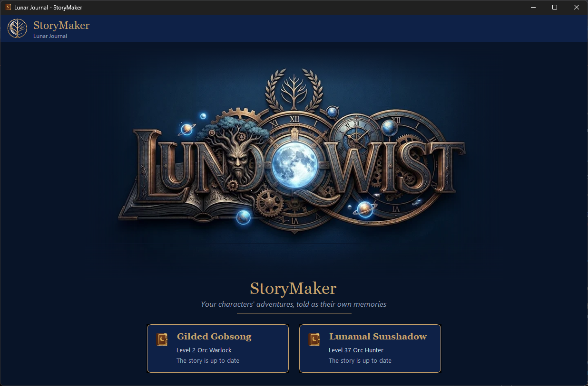
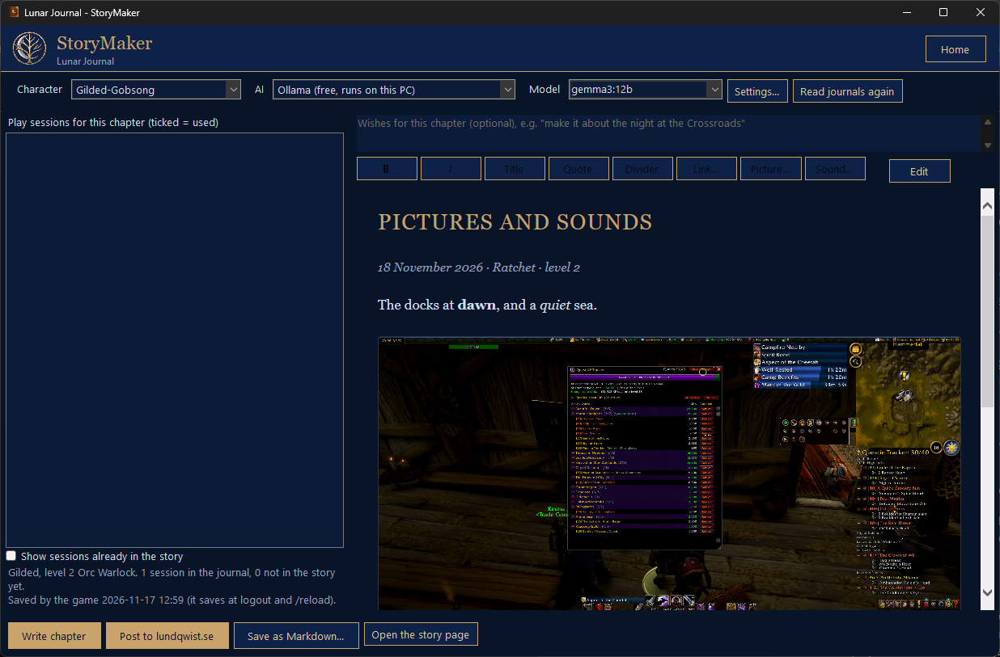
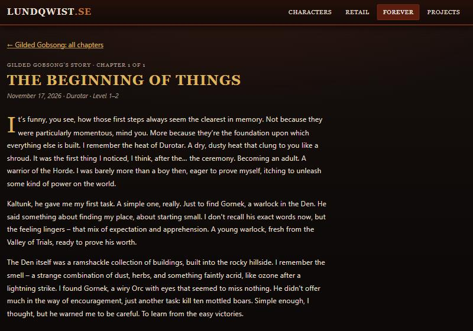

# Lunar Journal

**Keeps a journal of your adventures, so they can be told later.**

Made for **WoW Forever**. Type `/lj` or click the book button at the minimap.

You play. Lunar Journal quietly writes down what happens: which quests you took and who gave them to you, the people you met, how long you ran, rode and fished, what you crafted, where you died and what killed you, and what time of day it was in Azeroth.

The journal is made for **[StoryMaker](https://apps.microsoft.com/store/detail/9NH0SVRFBMRV?cid=DevShareMCLPCS)**, a Windows program available on the **Microsoft Store**. It hands the journal to an AI of your choosing, which writes a chapter of your character's life, told by the character himself, many years later, remembering. You read it, edit it if you like, and post it to your website or keep it on your PC.

See it live: [Gilded Gobsong's story](https://lundqwist.se/wowcharacters/forever/chapter.html?c=gilded-gobsong&n=1).

---

## What it records

For every play session, each entry with the real date and time and the in-game time of day:

- **Quests**: who offered them and where, with the quest text; when you accepted them; who you turned them in to, with the XP and money; abandoned quests.
- **People**: NPCs you talk to (quest givers, vendors, trainers, flight masters, innkeepers, bankers, auctioneers, stable masters), and players you group with, trade with or duel.
- **Time and distance**: running, riding, swimming, on flight paths, as a ghost, in combat, idle and resting; yards covered; time in each zone.
- **Professions**: time fishing and what you caught, time crafting and what you made, gathering (mining, herbalism, skinning) and what you got.
- **Moments**: level ups, deaths and what killed you, hearthstone trips, flights, rare and elite kills, rare and better loot, money gained and spent, screenshots.
- **Your own notes**: `/lj note Met an old orc at the crossroads who smelled of fish`. The AI is told these matter most.

## Commands

| Command | What it does |
|---|---|
| `/lj` | Show or hide the journal window: this session's summary and the latest entries |
| `/lj note <text>` | Write your own line in the journal |
| `/lj pause` | Pause or resume the journal |
| `/lj options` | The options page (also under Options → AddOns → Lunar Journal) |
| `/lj forget yes` | Delete this character's whole journal |

The options can switch off saving quest texts or counting kills, and can print a chat line for every entry. Left-click the minimap button to open the journal, right-click it for the options, drag it to move it.

The game saves the journal when you **log out or type `/reload`**, per character, in `WTF\Account\<account>\<realm>\<Character>\SavedVariables\LunarJournal.lua`. StoryMaker finds it there by itself.

## Turning the journal into a story

**[Get StoryMaker from the Microsoft Store](https://apps.microsoft.com/store/detail/9NH0SVRFBMRV?cid=DevShareMCLPCS)**: install it like any other Store app, or search for "StoryMaker" in the Microsoft Store on your PC. The Store keeps it up to date. It works with a free AI on your own PC (Ollama), or with Claude, OpenAI or Gemini. You edit each chapter as Markdown, add screenshots from the game and sounds, and post it to your website or save it on your PC. How to set it up is in [StoryMaker's README](https://github.com/Lundqwist/StoryMaker#readme).

## Privacy

- The addon records only your own character's actions. Chat is never recorded; other players appear only by name, when you group, trade or duel with them.
- Nothing leaves the game: the journal is a file on your PC.
- StoryMaker sends the journal only to the AI you choose (with Ollama it never leaves your PC), and only the finished chapter goes to your website.
- `/lj pause` stops the journal; `/lj forget yes` deletes it.

## Good to know

- The modern WoW client doesn't let addons read the combat log, so kills are counted from your target, focus, mouseover and nameplates: a unit counts when it dies after you were fighting it.
- Sometimes the game hides a value from addons, such as an NPC's name or a quest text. Lunar Journal then saves the entry without it instead of stopping with an error. Version 0.1.3 fixed the error at quest turn-in, and 0.1.4 fixed an error that came with it.

## Source and bugs

Source on GitHub: [Lundqwist/LunarJournal](https://github.com/Lundqwist/LunarJournal). Report bugs there under Issues. MIT license. World of Warcraft is a trademark of Blizzard Entertainment; this is a fan project.
