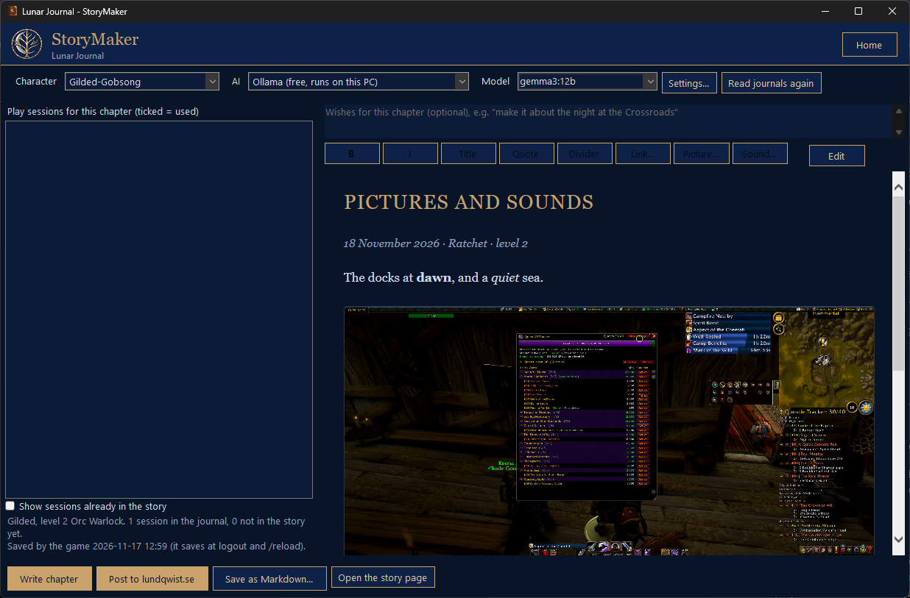

<p align="center">
  
</p>

<h1 align="center">Lunar Journal</h1>

<p align="center">
  A World of Warcraft: Forever addon that keeps a journal of your adventures,<br>
  for <a href="https://github.com/Lundqwist/StoryMaker"><b>StoryMaker</b></a>, the Windows program that lets an AI turn it into your character's own memories.
</p>

---

You play. The addon quietly writes down what happens: which quests you took and who gave them to
you, the people you met, how long you ran, rode and fished, what you crafted, where you died and
what killed you, and what time of day it was in Azeroth. Afterwards StoryMaker hands that journal
to an AI, which writes a chapter of your character's life, told by the character himself, many
years later, remembering. You read it, edit it if you like, and post it to your website, where
every chapter gets a page of its own.

See it live: [Gilded Gobsong's story](https://lundqwist.se/wowcharacters/forever/chapter.html?c=gilded-gobsong&n=1)
on lundqwist.se.





## Contents

- [What the addon records](#what-the-addon-records)
- [Installing the addon](#installing-the-addon)
- [Using the addon](#using-the-addon)
- [Turning the journal into a story: StoryMaker](#turning-the-journal-into-a-story-storymaker)
- [Privacy](#privacy)
- [For developers](#for-developers)

## What the addon records

For every play session, each entry with the real date and time and the in-game time of day:

| | |
|---|---|
| **Quests** | who offered them and where, with the quest text; when you accepted them; who you turned them in to, with the XP and money; abandoned quests |
| **People** | NPCs you talk to (quest givers, vendors, trainers, flight masters, innkeepers, bankers, auctioneers, stable masters), and players you group with, trade with or duel |
| **Time and distance** | running, riding, swimming, on flight paths, as a ghost, in combat, idle and resting; yards covered; time in each zone |
| **Professions** | time fishing and what you caught, time crafting and what you made, gathering (mining, herbalism, skinning) and what you got |
| **Moments** | level ups, deaths and what killed you, hearthstone trips, flights, rare and elite kills, rare and better loot, money gained and spent, screenshots |
| **Your own notes** | `/lj note Met an old orc at the crossroads who smelled of fish`. The AI is told these matter most |

## Installing the addon

Needs **World of Warcraft: Forever**.

1. On this page, click **Code → Download ZIP** and unpack it anywhere.
2. Open your game's AddOns folder, usually
   `C:\Program Files (x86)\World of Warcraft\_forever_\Interface\AddOns`.
3. Make a folder there called exactly **`LunarJournal`**, and copy these three files from the
   download into it:
   - `LunarJournal.toc`
   - `LunarJournal.lua`
   - `LunarLink.lua`
4. Start the game (or type `/reload`), and make sure **Lunar Journal** is ticked in the AddOns list
   on the character screen.

A book button appears at the minimap. That's it: the journal is now being written.

<details>
<summary>Installing with git instead (keeps it up to date with <code>git pull</code>)</summary>

```powershell
git clone https://github.com/Lundqwist/LunarJournal.git
cd LunarJournal
.\install.ps1 -AddOns "C:\Program Files (x86)\World of Warcraft\_forever_\Interface\AddOns"
```

`install.ps1` makes a link (a junction) from the AddOns folder to the cloned folder, so there is
only one copy. An older copy already in AddOns is moved aside, never deleted. `.\install.ps1 -Remove`
takes the link away again.
</details>

## Using the addon

| Command | |
|---|---|
| `/lj` | show or hide the journal window: this session's summary and the latest entries |
| `/lj note <text>` | write your own line in the journal |
| `/lj pause` | pause or resume the journal |
| `/lj options` | the options page (also under Options → AddOns → Lunar Journal) |
| `/lj forget yes` | delete this character's whole journal |

The options can switch off saving quest texts or counting kills, and can print a chat line for
every entry. Left-click the minimap button to open the journal, right-click it for the options,
and drag it to move it. With [LunarMods](https://github.com/Lundqwist/LunarMods) installed, the
options page can link the journal to the LM button instead.

The game saves the journal when you **log out or type `/reload`**, per character, in
`WTF\Account\<account>\<realm>\<Character>\SavedVariables\LunarJournal.lua`. StoryMaker reads it
from there.

## Turning the journal into a story: StoryMaker

**[StoryMaker](https://github.com/Lundqwist/StoryMaker)** is the Windows program that reads the
journal and lets an AI of your choosing (free with Ollama on your own PC, or Claude, OpenAI, Gemini)
write each chapter as the character's own memories. You edit it as Markdown, add screenshots from
the game and sounds, and post it to your website or save it on your PC.

**[Download StoryMaker for Windows](https://github.com/Lundqwist/StoryMaker/releases/latest)**: a normal
installer with .NET included, no admin rights needed. How to set it up, choose an AI and post to a
website is in [StoryMaker's README](https://github.com/Lundqwist/StoryMaker#readme).

StoryMaker finds the journals by itself in the game's `WTF\Account` folder.
## Privacy

- The addon records only your own character's actions. Chat is never recorded; other players
  appear only by name, when you group, trade or duel with them.
- Nothing leaves the game: the journal is a file on your PC.
- StoryMaker sends the journal only to the AI you choose (with Ollama it never leaves your PC), and
  only the finished chapter goes to your website.
- `/lj pause` stops the journal; `/lj forget yes` deletes it.

## For developers

| Folder / file | |
|---|---|
| `LunarJournal.toc`, `LunarJournal.lua` | the addon (Lua, interface 16001) |
| `LunarLink.lua` | shared by the Lunar mods: minimap button, options page, LunarMods link. The original is in [LunarMods](https://github.com/Lundqwist/LunarMods) (`shared\LunarLink.lua`) |
| `agent\`, `skill\` | an older way to write chapters with [Claude Code](https://claude.com/claude-code) instead of StoryMaker: `agent\journal.py` reads the journal, `skill\SKILL.md` is the `/wow-story` skill (`.\install-skill.ps1` installs it) |

The modern WoW client doesn't let addons read the combat log, so kills are counted from your
target, focus, mouseover and nameplates: a unit counts when it dies after you were fighting it.
A mob you never targeted, hovered or saw a nameplate for isn't counted.

## License

[MIT](LICENSE) © 2026 Bjarne Lundqwist. World of Warcraft is a trademark of Blizzard Entertainment;
this is a fan project.
