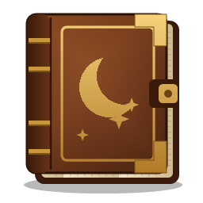
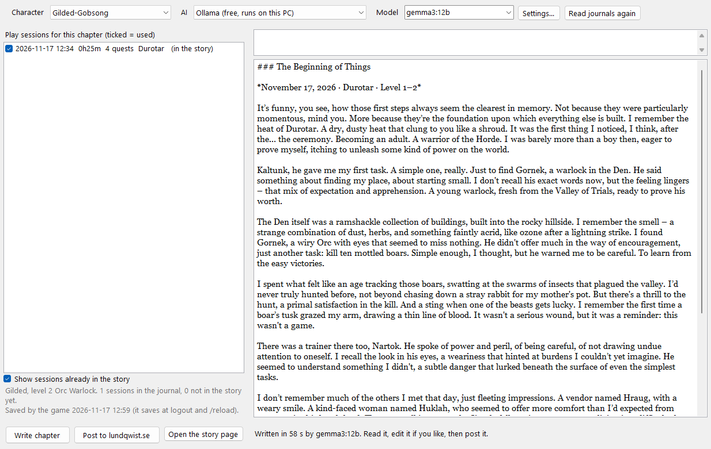
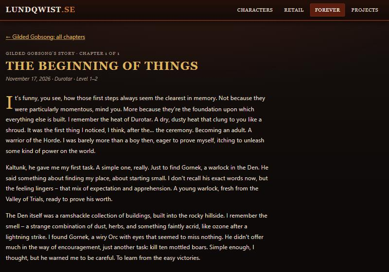

<p align="center">
  
</p>

<h1 align="center">Lunar Journal</h1>

<p align="center">
  A World of Warcraft: Forever addon that keeps a journal of your adventures,<br>
  and <b>StoryMaker</b>, a Windows program that lets an AI turn that journal into your character's own memories.
</p>

---

You play. The addon quietly writes down what happens: which quests you took and who gave them to
you, the people you met, how long you ran, rode and fished, what you crafted, where you died and
what killed you, and what time of day it was in Azeroth. Afterwards StoryMaker hands that journal
to an AI, which writes a chapter of your character's life, told by the character himself, many
years later, remembering. You read it, edit it if you like, and post it to your website, where
every chapter gets a page of its own.

See it live: [Gilded Gobsong's story](https://lundqwist.se/wowcharacters/forever/chapter.html?c=gilded-gobsong&n=1)
on lundqwist.se.





## Contents

- [What the addon records](#what-the-addon-records)
- [Installing the addon](#installing-the-addon)
- [Using the addon](#using-the-addon)
- [Installing StoryMaker](#installing-storymaker)
- [Choosing an AI](#choosing-an-ai)
- [Writing and posting a chapter](#writing-and-posting-a-chapter)
- [Posting to a website](#posting-to-a-website)
- [Privacy](#privacy)
- [For developers](#for-developers)

## What the addon records

For every play session, each entry with the real date and time and the in-game time of day:

| | |
|---|---|
| **Quests** | who offered them and where, with the quest text; when you accepted them; who you turned them in to, with the XP and money; abandoned quests |
| **People** | NPCs you talk to (quest givers, vendors, trainers, flight masters, innkeepers, bankers, auctioneers, stable masters), and players you group with, trade with or duel |
| **Time and distance** | running, riding, swimming, on flight paths, as a ghost, in combat, idle and resting; yards covered; time in each zone |
| **Professions** | time fishing and what you caught, time crafting and what you made, gathering (mining, herbalism, skinning) and what you got |
| **Moments** | level ups, deaths and what killed you, hearthstone trips, flights, rare and elite kills, rare and better loot, money gained and spent, screenshots |
| **Your own notes** | `/lj note Met an old orc at the crossroads who smelled of fish`. The AI is told these matter most |

## Installing the addon

Needs **World of Warcraft: Forever**.

1. On this page, click **Code → Download ZIP** and unpack it anywhere.
2. Open your game's AddOns folder, usually
   `C:\Program Files (x86)\World of Warcraft\_forever_\Interface\AddOns`.
3. Make a folder there called exactly **`LunarJournal`**, and copy these three files from the
   download into it:
   - `LunarJournal.toc`
   - `LunarJournal.lua`
   - `LunarLink.lua`
4. Start the game (or type `/reload`), and make sure **Lunar Journal** is ticked in the AddOns list
   on the character screen.

A book button appears at the minimap. That's it: the journal is now being written.

<details>
<summary>Installing with git instead (keeps it up to date with <code>git pull</code>)</summary>

```powershell
git clone https://github.com/Lundqwist/LunarJournal.git
cd LunarJournal
.\install.ps1 -AddOns "C:\Program Files (x86)\World of Warcraft\_forever_\Interface\AddOns"
```

`install.ps1` makes a link (a junction) from the AddOns folder to the cloned folder, so there is
only one copy. An older copy already in AddOns is moved aside, never deleted. `.\install.ps1 -Remove`
takes the link away again.
</details>

## Using the addon

| Command | |
|---|---|
| `/lj` | show or hide the journal window: this session's summary and the latest entries |
| `/lj note <text>` | write your own line in the journal |
| `/lj pause` | pause or resume the journal |
| `/lj options` | the options page (also under Options → AddOns → Lunar Journal) |
| `/lj forget yes` | delete this character's whole journal |

The options can switch off saving quest texts or counting kills, and can print a chat line for
every entry. Left-click the minimap button to open the journal, right-click it for the options,
and drag it to move it. With [LunarMods](https://github.com/Lundqwist/LunarMods) installed, the
options page can link the journal to the LM button instead.

The game saves the journal when you **log out or type `/reload`**, per character, in
`WTF\Account\<account>\<realm>\<Character>\SavedVariables\LunarJournal.lua`. StoryMaker reads it
from there.

## Installing StoryMaker

Needs **Windows 10 or 11** and the **[.NET 8 SDK](https://dotnet.microsoft.com/download/dotnet/8.0)**
(to build it; running it only needs the .NET 8 Desktop Runtime, which comes with the SDK).

1. Download the repository (**Code → Download ZIP**, or `git clone`), and unpack it.
2. Open PowerShell in the unpacked folder and run:

   ```powershell
   .\StoryMaker\install.ps1
   ```

   This builds StoryMaker into `%LOCALAPPDATA%\LunarJournal\StoryMaker` and adds
   **Lunar Journal StoryMaker** to the Start menu. Run it again to update; `-Remove` uninstalls it.
   (If Windows refuses to run the script, run `Set-ExecutionPolicy -Scope CurrentUser RemoteSigned` once.)
3. Start **Lunar Journal StoryMaker** from the Start menu and open **Settings...**:
   - **Look**: light or dark (by default it follows Windows' own setting).
   - **WTF\Account folder**: your game's `_forever_\WTF\Account` folder, if it isn't in the
     default place.
   - The **website** and **AI** settings: see the next sections.

## Choosing an AI

StoryMaker can write with any of these. Pick one in the **AI** box at the top, and the model next
to it.

| AI | Cost | Set up |
|---|---|---|
| **Ollama** (default) | free, runs on your own PC, works offline | Install [Ollama](https://ollama.com) (`winget install Ollama.Ollama`) and download a model: `ollama pull gemma3:12b` (about 8 GB; best with a graphics card with 12 GB). A chapter takes about a minute. |
| **Claude** (Anthropic) | paid per use | Create an API key at [console.anthropic.com](https://console.anthropic.com), then `setx ANTHROPIC_API_KEY "sk-ant-..."`. Writes the best stories. |
| **OpenAI** | paid per use | `setx OPENAI_API_KEY "..."` |
| **Gemini** (Google) | has a free tier | A key from [Google AI Studio](https://aistudio.google.com), then `setx GEMINI_API_KEY "..."` |
| **OpenAI-compatible** | depends | Any server that speaks OpenAI's chat API (LM Studio, OpenRouter...): set its address in Settings |

Keys are never stored by StoryMaker: it reads them from Windows user environment variables, and
Settings shows which ones it found. After `setx`, start StoryMaker again so it sees the new value.
A local model is weaker than Claude and now and then gets a detail wrong, which is why you read
every chapter before it's posted.

## Writing and posting a chapter

1. Play with the addon on, then log out or `/reload`.
2. In StoryMaker, press **Read journals again** and pick your **character**.
3. The **play sessions** not yet in the story are ticked. Untick any you want to leave out.
4. Optionally write **wishes** for this chapter ("make it about the night at the Crossroads").
5. Press **Write chapter**. StoryMaker reads the story so far from your website, so the new
   chapter carries on from the last one, and sends it and the journal to the AI.
6. Read the chapter and edit it in the box as much as you like.
7. Press **Post to lundqwist.se**. It becomes the story's next chapter, and the sessions you used
   count as told. **Open the new chapter** shows it on the site.

   Or press **Save as Markdown...** to keep it on your own PC. It suggests
   `Documents\Lunar Journal\<Character>\002 <title>.md`, numbered after the chapters already
   saved there, but you can save it anywhere. It then asks whether the sessions you used should
   count as told.

## Posting to a website

StoryMaker posts to a small story API on the website. It's built for
[WowCharacters](https://github.com/Lundqwist/WowCharacters), which runs
[lundqwist.se/wowcharacters](https://lundqwist.se/wowcharacters/): each character's page lists the
chapters, and every chapter has its own page with links to the one before and after. To run it for
your own characters:

1. Set up WowCharacters (see its README) and add your characters to its `characters.json`. A
   character's name there is the journal's folder name in lower case: `Gilded-Gobsong` →
   `gilded-gobsong`.
2. Put a long random secret in the site's `.env` as `STORY_TOKEN=` (at least 32 characters), and
   the same value on your PC: `setx STORY_TOKEN "..."`.
3. In StoryMaker's Settings, set the **site address**, e.g. `https://example.com/wowcharacters`.

Another site can take the posts too, if it answers the same two calls (both with
`Authorization: Bearer <STORY_TOKEN>`):

| | |
|---|---|
| `GET {site}/api/forever/story?c=<character>` | `{ "markdown": "..." }`: the whole story so far |
| `POST {site}/api/forever/story?c=<character>` with `{ "markdown": "..." }` | saves it as the next chapter, answers `{ "chapter": 3 }` |

**You don't need a website.** Without one, save each chapter with **Save as Markdown...**. When
no `STORY_TOKEN` is set, StoryMaker uses the chapters saved in the character's folder as the
story so far, so the next chapter still carries on from the last.

## Privacy

- The addon records only your own character's actions. Chat is never recorded; other players
  appear only by name, when you group, trade or duel with them.
- Nothing leaves the game: the journal is a file on your PC.
- StoryMaker sends the journal only to the AI you choose (with Ollama it never leaves your PC), and
  only the finished chapter goes to your website.
- `/lj pause` stops the journal; `/lj forget yes` deletes it.

## For developers

| Folder / file | |
|---|---|
| `LunarJournal.toc`, `LunarJournal.lua` | the addon (Lua, interface 16001) |
| `LunarLink.lua` | shared by the Lunar mods: minimap button, options page, LunarMods link. The original is in [LunarMods](https://github.com/Lundqwist/LunarMods) (`shared\LunarLink.lua`) |
| `StoryMaker\` | the Windows program: .NET 8, WinForms. `Journal.cs` reads WoW's saved-variables files, `StoryPrompt.cs` is what every AI is told, `Writers.cs` holds the AIs (Claude through Anthropic's official C# SDK), `SiteClient.cs` the website API |
| `StoryMaker\tools\make-icon.ps1` | draws the book icon |
| `agent\`, `skill\` | an older way to write chapters with [Claude Code](https://claude.com/claude-code) instead of StoryMaker: `agent\journal.py` reads the journal, `skill\SKILL.md` is the `/wow-story` skill (`.\install-skill.ps1` installs it) |

Settings and which sessions are told: `%APPDATA%\LunarJournal\StoryMaker.json`.

The modern WoW client doesn't let addons read the combat log, so kills are counted from your
target, focus, mouseover and nameplates: a unit counts when it dies after you were fighting it.
A mob you never targeted, hovered or saw a nameplate for isn't counted.

## License

[MIT](LICENSE) © 2026 Bjarne Lundqwist. World of Warcraft is a trademark of Blizzard Entertainment;
this is a fan project.
